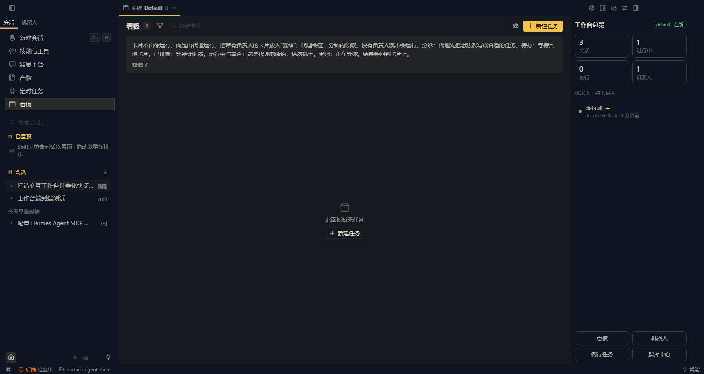

# Hermes 工作台（hermes-workbench）

> 基于 **Hermes Agent 桌面端**搭建的多智能体协作工作台快照：把 6 款 AI 软件作为「软件本体执行」的智能体接入同一块看板（Kanban），配合一组常驻守护进程，实现长时间无人值守地跑任务、防睡眠、防欠费、防误关机。
>
> 本仓库为个人工作台的可复刻整理版。所有密钥、令牌均已脱敏为占位符（`<YOUR_API_KEY>`）；路径中的 Windows 用户名与 GitHub 账号亦已占位化（`<用户名>`、`<你的GitHub用户名>`）。



---

## 1. 这是什么

| 组成 | 说明 |
|---|---|
| **看板（Kanban）** | `kanban.db`（SQLite，`tasks / task_comments / task_events`），卡片即任务；每张卡声明**执行引擎**（软件自身执行 vs Hermes 工作进程代执行），由工作台图谱插件可视化 |
| **六个软件智能体** | Claude Code、DeepSeek Harness、Qoder、Trae、Trae Solo、WorkBuddy —— 各自用**软件本体的模型与账号**执行任务，Hermes 只做调度与监工 |
| **守护进程组** | 防睡眠（任务感知）、模型额度守卫、任务完成自动关机看护、网关监管、卡片监听等（见 `daemons/`） |
| **本地模型网关** | WorkBuddy 桥的免费模型出口：`workbuddy2api` → `http://127.0.0.1:8787/v1`（见 `gateway/`） |
| **插件** | `workbench-graph`（看板图谱 + 后端 API）、`workbench-overview`、`workbench-field`（桌面插件），界面全中文 |

### 架构总览

```
┌────────────────────────── Hermes 桌面端（中文界面） ──────────────────────────┐
│  看板插件 workbench-graph ── plugin_api.py ──► kanban.db                     │
│  桌面插件   workbench-overview / workbench-field                              │
└───────────────▲───────────────────────────────────────────────▲─────────────┘
                │ 调度（Hermes 本体: DeepSeek）                    │ 状态回写
┌───────────────┴───────────────┐                 ┌─────────────┴─────────────┐
│  六个软件智能体（本体执行）    │                 │  守护进程组（.build/workbench）│
│  claude-code   deepseek-harness│                 │  80/90 防睡眠  73 额度守卫    │
│  qoder  trae  trae-solo  workbuddy│              │  88 关机看护  83 网关重启     │
└───────────────┬───────────────┘                 │  87 卡片监听  89 取消倒计时   │
                │ 免费模型出口                      └───────────────────────────┘
        ┌───────┴────────┐
        │ 网关 :8787     │◄── supervisor.ps1（HTTP 健康检查 + 退避重启）
        │ workbuddy2api  │
        └────────────────┘
```

## 2. 目录结构

```
hermes-workbench/
├── config/                     # Hermes 配置（已脱敏）
│   ├── config.yaml             #   主配置（模型、MCP、插件开关、压缩链）
│   └── profiles/<六个软件>/config.yaml
├── daemons/                    # 常驻守护脚本 + 使用说明
├── gateway/                    # 本地免费模型网关（supervisor / 登录助手 / 服务启动器）
├── startup/                    # Windows 启动文件夹模板（开机自启）
├── plugins/
│   ├── workbench-graph/        #   看板插件（dashboard/ + 运行时文件）
│   └── desktop-plugins/        #   三个桌面插件（plugin.js）
├── tools/                      # 构建期与运维脚本（含 QQ 机器人一键绑定）
├── docs/                       # 架构 / 复刻步骤 / 执行分工 / 审计报告 / 各智能体设定
└── assets/screenshots/         # 界面截图与图标
```

## 3. 六个软件智能体

| 智能体 | 执行引擎（本体） | 接入方式 | 备注 |
|---|---|---|---|
| claude-code | 云知声 U2 Flash（限免期，2026-10-31 止） | Claude Code CLI + `~/.claude/settings.json` | 任务派发走看板卡片 |
| deepseek-harness | 用户 DeepSeek 账号 | `dsh.cmd --profile headless` + `~/.dsh/.credentials.yaml` | 无头执行 |
| qoder | Qoder 账号（软件内置模型） | Qoder 桌面端自动化 | 额度在软件内查看 |
| trae | Trae 账号（软件内置模型） | Trae 桌面端自动化 | 同上 |
| trae-solo | Trae 账号（Solo 模式） | Trae Solo 桌面端 | 同上 |
| workbuddy | 腾讯限免三模型（step-5-preview / hy4-preview-f / hy3） | 经本机网关 `:8787` | 配 fallback 链 → DeepSeek |

> 工作台规则：每张卡片必须声明执行引擎；用户会逐卡审计「软件自身执行」与「Hermes 代执行」的区别。

## 4. 守护进程速查

| 脚本 | 作用 |
|---|---|
| `80-task-keepawake.py` + `90-keepawake.cmd` + `81-keepawake-autostart.vbs` | **任务感知防睡眠 v3.1**：忙时把 AC 睡眠超时置 0，闲时还原；单实例互斥、属主戳、自修复、`--restore` |
| `73-wb-quota.py` | 网关模型**额度守卫**：限免窗口管理（过期即停用/切换）、`guard / pick / restore` |
| `74-wb-fallback-setup.py` | 配置 WorkBuddy 桥的 fallback 链（hy4→hy3→deepseek） |
| `88-watch-shutdown.py` | **任务完成后自动关机**看护（保守策略：仅 done 触发、全局复查、DB 失败不关机） |
| `89-cancel-countdown.py` / `90-keepawake.cmd cancel-shutdown` | 应急：取消关机倒计时并停掉看护 |
| `87-watch-cards.py` | 卡片状态监听器（无参数打印用法） |
| `83-gateway-relaunch.ps1` | 重启 **Hermes 消息网关**（按命令行精确匹配，绝不按进程名杀） |
| `82-qq-onboard.py` / `85-show-qq-qr.py` / `86-apply-qq-env.py` | QQ 官方机器人一键绑定链路 |

## 5. 快速复刻

完整步骤见 [`docs/reproduction.md`](docs/reproduction.md)。最小路径：

1. 安装 Hermes Agent（`hermes-agent-main` + `.venv`）、`uv`、`gh`；
2. 拷贝 `config/` 到 `%LOCALAPPDATA%\hermes\`，把 `<YOUR_API_KEY>` 换成真实密钥；
3. 安装并登录六款软件本体，拷贝 `plugins/` 到对应目录；
4. 拷贝 `daemons/` 到 `<repo>\.build\workbench\`，把 `startup/` 两个 VBS 放进「启动」文件夹；
5. 部署 `gateway/`（`uv run --with workbuddy2api python -m codebuddy_proxy`）；
6. 按 `docs/reproduction.md` 的验证清单逐项核对（或一步跑完：`python tools/verify-install.py`）。

## 6. 安全说明

- 仓库内所有 `api_key` 均为占位符；真实密钥只存在于本机配置文件与各软件的凭据库中；
- 所有文件中的 Windows 用户名（`C:\Users\...` 类路径）与 GitHub 账号名均已替换为占位符；提交历史已重写为脱敏后的干净历史；
- 网关的 `codebuddy-local` 是本机回环占位令牌，不含任何真实凭据；
- 日志、数据库、缓存（`*.log / *.db / proxy.jsonl` 等）一律不入库（见 `.gitignore`）。

## 7. 文档

- [`docs/architecture.md`](docs/architecture.md) —— 组件、数据流、卡片生命周期
- [`docs/orchestration.md`](docs/orchestration.md) —— 执行分工与派活规约（三层架构 / 通道命令 / 验收规约）
- [`docs/reproduction.md`](docs/reproduction.md) —— 从零复刻步骤 + 验证清单
- [`docs/changelog-2026-10-12.md`](docs/changelog-2026-10-12.md) —— 2026-10-12 深度检查与优化轮记录
- [`docs/audits/`](docs/audits) —— 三路代码/守护/i18n 审计报告（含执行引擎声明）
- [`docs/agents/`](docs/agents) —— 六个智能体的设定（soul 文档）

## 8. 许可

本项目采用 [MIT 许可证](LICENSE)。

---
*本仓库由工作台自身在 2026-10-12 的「全面检查与优化」轮后整理生成。*
